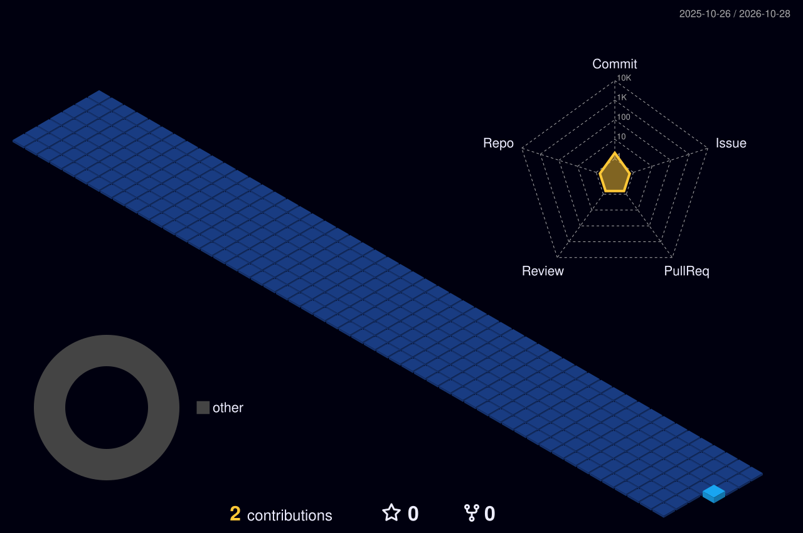

## 📂 Projects

| Project | What it does | Stack |
|---|---|---|
| [apps-script-automation](https://github.com/Rishabh6984/apps-script-automation) | Daily sales report emailer, Google Form → Sheet logger and a mini web-app dashboard | Google Apps Script · Sheets · HTML |
| [hotel-booking-analysis](https://github.com/Rishabh6984/hotel-booking-analysis) | EDA of resort vs city hotel bookings — ADR, cancellations, seasonality, top agents | Python · Pandas · NumPy · Matplotlib · Seaborn |
| [sql-retail-analytics](https://github.com/Rishabh6984/sql-retail-analytics) | Supermarket sales schema + 20 analytical queries (ranking, YoY, basket size) | MySQL |
| [portfolio-website](https://github.com/Rishabh6984/portfolio-website) | Responsive personal portfolio, deployable on GitHub Pages | HTML · CSS · JavaScript |
| [Bharat_Intern](https://github.com/Rishabh6984/Bharat_Intern) | Internship task submissions | Python / Web |

## 🏙️ Contribution city

## 📜 Certifications

**SQL Certification Course** — Geekster · **Data Analytics Essentials** — Cisco · **Data Analyst** — NetTech India

[LinkedIn](https://linkedin.com/in/rishabhchaurasiya240) · [Email](mailto:chaurasiyarishabh240@gmail.com)

